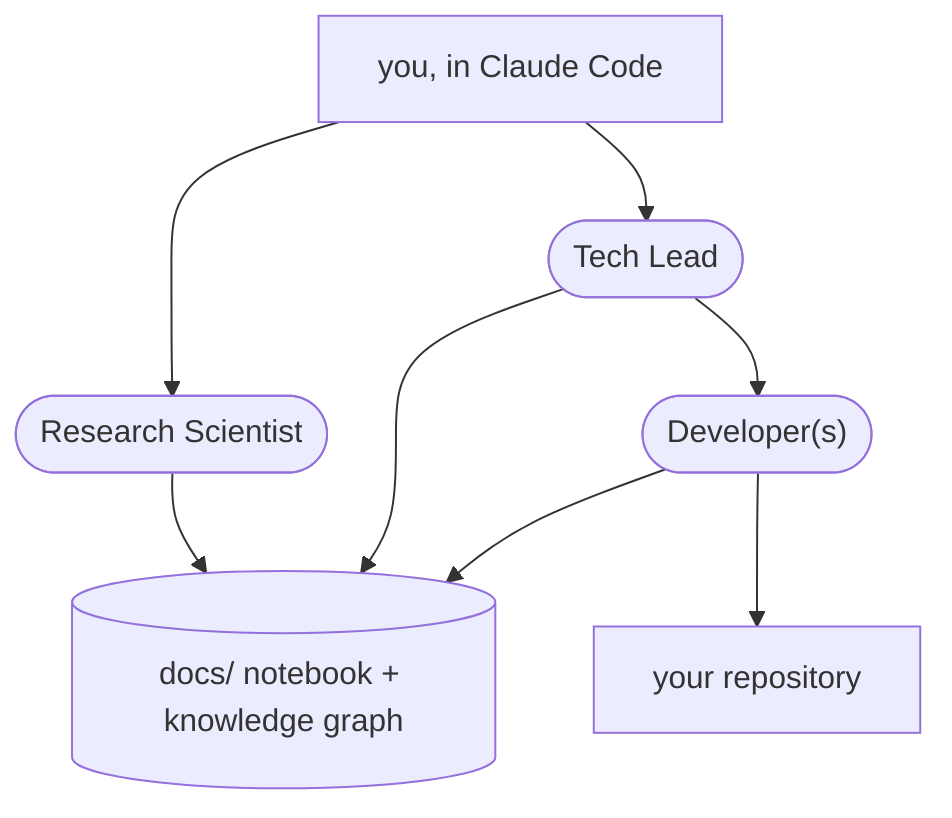
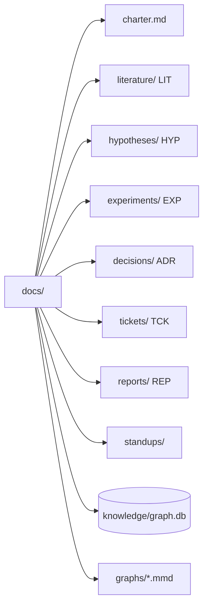
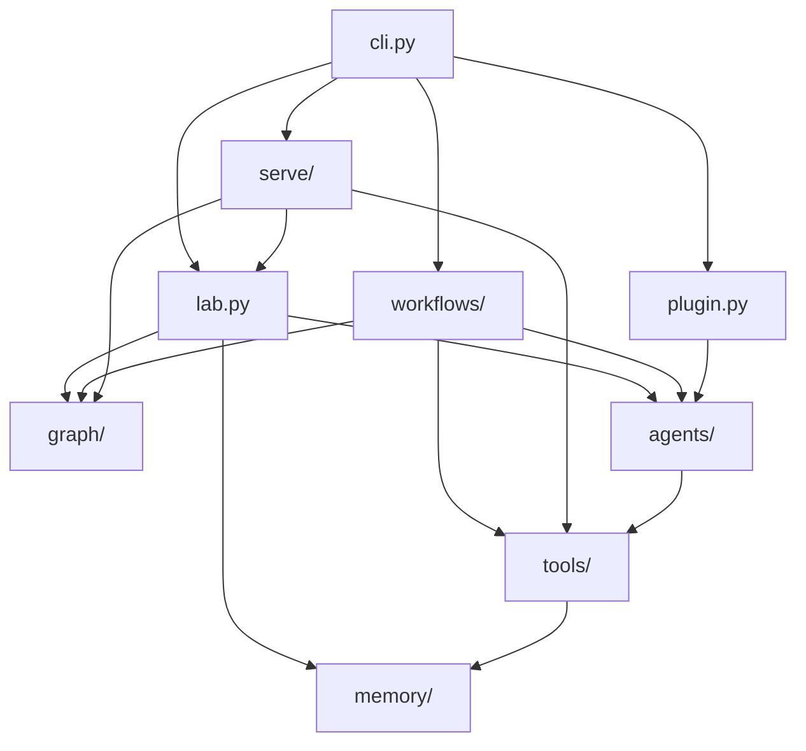

# TRE

**A three-agent ML research system that lives on your repository.**

TRE puts a Research Scientist, a Tech Lead, and a Developer on top of any git repo plus a `docs/` notebook. You speak to the Scientist and the Lead from a Claude Code session through the TRE plugin; the Developer works under the Lead; a loopback daemon (`tre serve`) runs the workflows as supervised workers so a study outlives any session. Every role runs typed workflow graphs — built on a purpose-built graph engine over the [Claude Agent SDK](https://docs.claude.com/en/api/agent-sdk/overview) — and everything they learn, decide, build, and conclude lands in the notebook and a research knowledge graph with full lineage: hypothesis → experiment → result.



| Role | Owns | How |
| --- | --- | --- |
| Research Scientist | the science | literature, falsifiable hypotheses, pre-registered designs, analysis, interpretation, red-teaming |
| Tech Lead | the engineering | repo recon, ADRs, ticket DAGs, diff-level code review, integration |
| Developer(s) | one ticket each, under the Lead | tests first, engine-run suites, bounded debug loops, structured self-review; parallel in isolated git worktrees |

## Why graphs

Agent quality comes from structure, not vibes. Each workflow is an explicit directed graph: typed pydantic state with reducer semantics, deterministic edges, conditional routers, bounded loops, per-node retries, human approval gates, and a checkpoint after every step — so any run (including one paused at a gate, or one that died mid-flight) resumes exactly where it stopped. Fan-out happens inside map nodes with bounded concurrency, so the graph stays deterministic while searches, paper annotations, and Developer tickets run in parallel. Every graph exports to Mermaid (`tre graph study`, or the committed exports in [`assets/`](assets)).

The second graph is the **research knowledge graph** (`docs/knowledge/graph.db`): papers, hypotheses, experiments, results, tickets, and ADRs as typed nodes, with `tests`, `supports`, `refutes`, `implements`, `depends_on` edges. "What evidence bears on HYP-002?" is one lineage query, and every workflow maintains it as it works.

## The workflows

| workflow       | owner     | graph                                           | what happens                                                                                                                                                                                                                                                                                  |
| -------------- | --------- | ----------------------------------------------- | --------------------------------------------------------------------------------------------------------------------------------------------------------------------------------------------------------------------------------------------------------------------------------------------- |
| `literature` | Scientist | [`literature.mmd`](assets/literature.mmd) | query planning → parallel arXiv + Semantic Scholar + HF Papers search → triage against explicit criteria → full-text deep read of top papers → one structured note per paper (parallel) → synthesis → adversarial self-critique loop → notes, review, and citations persisted          |
| `design`     | Scientist | [`design.mmd`](assets/design.mmd)         | 3 candidate hypotheses (falsifiability, predicted effect, novelty/tractability/impact scores) → pre-registered design (baselines, ablations, seeds, power, stop criteria) → **Tech Lead feasibility review loop** → **human approval gate** → HYP/EXP registered              |
| `plan`       | Lead      | [`plan.mmd`](assets/plan.mmd)             | repo recon → ADR → 2–6 tickets with verifiable acceptance criteria, test plans, and dependencies → dependency waves computed                                                                                                                                                              |
| `execute`    | Lead      | [`execute.mmd`](assets/execute.mmd)       | **human go/no-go** → per wave: parallel Developers in isolated git worktrees → Lead reviews real diffs against a fixed rubric → bounded fix rounds (a blocked Developer's question gets answered in review comments) → merge + full test suite → integration report                |
| `ticket`     | Developer | [`ticket.mmd`](assets/ticket.mmd)         | one ticket: gather context → plan → tests-first implementation → engine-run test suite (the agent never grades its own homework) → bounded debug loop → structured self-review → commit + hand-off                                                                                      |
| `analysis`   | Scientist | [`analysis.mmd`](assets/analysis.mmd)     | load results → data-integrity check → **deterministic statistics in code** (means, CIs, Cohen's d, bootstrap — models interpret, code computes) → interpretation against the pre-registered falsification criteria → red-team pass → report, statuses, and supports/refutes edges |
| `study`      | all       | [`study.mmd`](assets/study.mmd)           | the full loop: literature → design → plan → execute → analysis → retro, then **iterate** (with a sharpened focus) or **conclude** — bounded, gated, resumable                                                                                                               |

Techniques wired in where they earn their keep: best-of-N hypothesis generation with explicit scoring, reflexion-style self-critique loops, adversarial red-teaming of conclusions, plan-then-execute decomposition, TDD with execution feedback, cross-role review contracts, structured outputs validated at the SDK layer, deterministic code for all arithmetic, and cost accounting per node.

## The graphs

Every workflow is a graph, and every graph ships as a Mermaid file under [`assets/`](assets): one per workflow, plus `knowledge.mmd` for the research knowledge graph. `tre graph <workflow>` prints one; `tre graph --export --out assets` regenerates this folder from the current code, so the files are the generated record of what the engine runs. Without `--out`, the export lands in the attached repository's `docs/graphs/`.

Node shapes carry the node kind: `([ ])` is an agent turn, `[[ ]]` a tool or code node, `{ }` a human gate, `[ ]` glue. The study graph splices the five phase graphs (literature, design, plan, execute, analysis) into one checkpointed run, with a retro that iterates or concludes:

```mermaid
flowchart TD
    S((" ")):::term
    E(("done")):::term
    lit_pull_context[["lit pull context"]]:::tool
    lit_plan_queries(["lit plan queries"]):::agent
    lit_search[["lit search"]]:::tool
    lit_triage(["lit triage"]):::agent
    lit_deep_read[["lit deep read"]]:::tool
    lit_annotate[["lit annotate"]]:::tool
    lit_synthesize(["lit synthesize"]):::agent
    lit_self_critique(["lit self critique"]):::agent
    lit_persist[["lit persist"]]:::tool
    des_pull_design_context[["des pull design context"]]:::tool
    des_hypothesize(["des hypothesize"]):::agent
    des_draft_design(["des draft design"]):::agent
    des_feasibility(["des feasibility"]):::agent
    des_approve_design{"des approve design"}:::gate
    des_register[["des register"]]:::tool
    plan_recon[["plan recon"]]:::tool
    plan_draft_adr(["plan draft adr"]):::agent
    plan_decompose(["plan decompose"]):::agent
    plan_persist_plan[["plan persist plan"]]:::tool
    exec_load_plan[["exec load plan"]]:::tool
    exec_approve_execution{"exec approve execution"}:::gate
    exec_abort["exec abort"]:::task
    exec_dispatch_wave[["exec dispatch wave"]]:::tool
    exec_review_wave[["exec review wave"]]:::tool
    exec_fix_wave[["exec fix wave"]]:::tool
    exec_integrate[["exec integrate"]]:::tool
    exec_report(["exec report"]):::agent
    exec_persist_exec[["exec persist exec"]]:::tool
    ana_load_results[["ana load results"]]:::tool
    ana_sanity(["ana sanity"]):::agent
    ana_compute_stats[["ana compute stats"]]:::tool
    ana_interpret(["ana interpret"]):::agent
    ana_red_team(["ana red team"]):::agent
    ana_persist_analysis[["ana persist analysis"]]:::tool
    kickoff["kickoff"]:::task
    bridge_lit_design["bridge lit design"]:::task
    check_design_approval["check design approval"]:::task
    study_halted["study halted"]:::task
    bridge_exec_analysis["bridge exec analysis"]:::task
    retro(["retro"]):::agent
    iterate_reset["iterate reset"]:::task
    conclude["conclude"]:::task
    lit_pull_context --> lit_plan_queries
    lit_plan_queries --> lit_search
    lit_search --> lit_triage
    lit_triage --> lit_deep_read
    lit_deep_read --> lit_annotate
    lit_annotate --> lit_synthesize
    lit_synthesize --> lit_self_critique
    des_pull_design_context --> des_hypothesize
    des_hypothesize --> des_draft_design
    des_draft_design --> des_feasibility
    des_approve_design --> des_register
    plan_recon --> plan_draft_adr
    plan_draft_adr --> plan_decompose
    plan_decompose --> plan_persist_plan
    exec_load_plan --> exec_approve_execution
    exec_dispatch_wave --> exec_review_wave
    exec_fix_wave --> exec_review_wave
    exec_report --> exec_persist_exec
    ana_load_results --> ana_sanity
    ana_sanity --> ana_compute_stats
    ana_compute_stats --> ana_interpret
    ana_interpret --> ana_red_team
    S --> kickoff
    kickoff --> lit_pull_context
    lit_persist --> bridge_lit_design
    bridge_lit_design --> des_pull_design_context
    des_register --> check_design_approval
    study_halted --> E
    plan_persist_plan --> exec_load_plan
    exec_abort --> E
    exec_persist_exec --> bridge_exec_analysis
    bridge_exec_analysis --> ana_load_results
    ana_persist_analysis --> retro
    iterate_reset --> des_pull_design_context
    conclude --> E
    lit_self_critique -->|revise| lit_synthesize
    lit_self_critique -->|accept| lit_persist
    des_feasibility -->|revise| des_draft_design
    des_feasibility -->|approve| des_approve_design
    exec_approve_execution -->|go| exec_dispatch_wave
    exec_approve_execution -->|abort| exec_abort
    exec_review_wave -->|fix| exec_fix_wave
    exec_review_wave -->|integrate| exec_integrate
    exec_integrate -->|next| exec_dispatch_wave
    exec_integrate -->|report| exec_report
    ana_red_team -->|reinterpret| ana_interpret
    ana_red_team -->|persist| ana_persist_analysis
    check_design_approval -->|go| plan_recon
    check_design_approval -->|halt| study_halted
    retro -->|iterate| iterate_reset
    retro -->|conclude| conclude
    classDef agent fill:#dbeafe,stroke:#2563eb,color:#1e3a8a
    classDef tool fill:#dcfce7,stroke:#16a34a,color:#14532d
    classDef task fill:#f1f5f9,stroke:#64748b,color:#0f172a
    classDef gate fill:#fef3c7,stroke:#d97706,color:#78350f
    classDef sub fill:#ede9fe,stroke:#7c3aed,color:#4c1d95
    classDef term fill:#0f172a,stroke:#0f172a,color:#f8fafc
```



`knowledge.mmd` is the knowledge graph of a fresh `tre init`: the type legend and no nodes. It fills as workflows register papers, hypotheses, experiments, tickets, and reports.

## Quickstart

```bash
pip install -e .                      # from this repo; Python 3.10+
tre serve                           # the daemon: one per machine, loopback only (127.0.0.1:8765)
```

`contrib/tre.service` runs the daemon as a systemd user unit; its header holds the install commands. Workers authenticate the way Claude Code does on the machine, or through `ANTHROPIC_API_KEY`.

Then, in Claude Code, load the plugin from this checkout (`claude --plugin-dir /path/to/tre`), or attach the daemon to any project with `claude mcp add --transport http tre http://127.0.0.1:8765/mcp`. Ask for a TRE run in plain words; the `tre` skill registers the repository, starts the workflow, watches it to its exit line, and brings each gate to you as a question. The `research-scientist` and `tech-lead` skills put the session in either role's charter for the conversation around a run.

The same runs work from a terminal, streaming live and prompting at gates:

```bash
cd ~/code/my-research-repo
tre init .                          # docs/ notebook + knowledge graph + config

tre run literature "does curriculum ordering improve sample efficiency in RLHF?"
tre run design     "curriculum ordering in RLHF"
tre run plan       EXP-001
tre run execute    EXP-001
tre run analysis   EXP-001
tre run study "does curriculum ordering improve sample efficiency in RLHF?"   # or all of it

tre run study --resume 20260806-142355-study --answer des_approve_design=yes   # a gate paused it; answer later
tre run study "..." --yes           # auto-approve all gates
tre run design "..." --headless     # no prompt: a gate ends the process with exit 3 and status waiting_gate
tre wait <run_id>                   # block until the run leaves running, then print its exit line
tre status [<run_id> --json]        # runs, states, gates, costs
tre costs                           # spend by workflow
tre standup                         # today's summary from runs + notebook
tre graph study                     # Mermaid for any workflow
```

## Serve and the plugin

`tre serve` is a supervisor over durable files, exposed as an MCP server on streamable HTTP. Each run is a `tre run --headless` worker in its own process group; the daemon holds pids and a registry of repository roots (`~/.tre/registry.json`), and everything else lives under `<repo>/.tre/runs/<run_id>/` (`meta.json`, `state.json`, `steps.jsonl`, `events.jsonl`, `worker.json`). A daemon restart rescans the disk: live workers are adopted, a run whose worker died is relaunched once from its checkpoint, and a run waiting at a gate keeps waiting. A gate ends the worker with status `waiting_gate`; `run_answer` starts a resume worker, and the engine's once-per-visit answer queue is untouched.

Every run ends on one line its launcher writes, which is what a watcher looks for:

```text
[tre] <run_id> exit <code> status=<status> gate=<gate or ->
```

`tre wait <run_id> -p <repo>` blocks until that line, through `queued` and `running`, and exits 0 on `completed`, 3 on `waiting_gate`, 1 otherwise; when the worker's pid is gone for two polls it prints `status=died` and exits 1 without writing, since recording `died` is the daemon's job. The plugin's `tre` skill arms one Monitor per run on that command plus a fail-safe cron that calls `run_status`, and never relies on a push from the daemon: silence is never read as success.

| Surface | Names |
| --- | --- |
| run tools | `repo_register`, `repo_list`, `run_start`, `run_status`, `run_answer`, `run_cancel`, `run_list`, `costs`, `standup` |
| notebook and knowledge-graph tools | the thirteen `lab` tools agents also use, each taking a registered `repo`: paper search and fetch, notebook create, read, append, set status, list, knowledge-graph add node, link, query, lineage, repo map, read-only git |
| resources | `tre://repos`, `tre://gates` (every run waiting at a gate, with its message), `tre://runs/{run_id}/events?tail=N` |
| skills | `tre` (the operating loop), `research-scientist` and `tech-lead` (the charters, generated from `tre/agents/personas.py` by `tre plugin-sync`, with a test that fails on drift) |

The daemon binds loopback only and refuses any other host. It is one Anthropic identity and one bill; the global cap on live workers is `[serve] max_concurrent_runs` in `~/.tre/config.toml` (default 2), and runs past it queue.

## The notebook convention



`charter.md` is the study's single source of truth plus a running journal. Each entry kind has a folder and an ID prefix: one structured note per paper, a hypothesis with its falsification criteria and status, an experiment's pre-registration plus append-only log (results under `experiments/runs/EXP-.../`), architecture decision records, tickets with acceptance criteria and test plans, and reports. `standups/` holds generated daily summaries; `knowledge/graph.db` is the knowledge graph (SQLite plus JSON export); `graphs/` holds the Mermaid exports.

Entries carry flat frontmatter (id, status, links) and `[[ID]]` cross-links; INDEX.md files are generated, never hand-edited. Humans edit the notebook freely — it's markdown; agents read and write it through tools. Statuses move honestly: a hypothesis ends `supported`, `refuted`, or `inconclusive`, never quietly forgotten.

## Guardrails

Agent turns run under deny-by-default hooks regardless of prompt content: no `git push`, no `sudo`, no destructive `rm` on absolute paths, no piping downloads into shells, no writes outside the repository. Review gates are human-owned unless you pass `--yes`. Loops are bounded everywhere (revision rounds, debug rounds, fix rounds, study iterations, per-node visit caps, global step caps), and `max_budget_usd_per_run` can cap spend per agent call. The engine — not any agent — runs test suites and computes statistics.

## Configuration

`.tre/config.toml` (written by `tre init`, every key optional):

```toml
[models]
research_scientist = "sonnet"    # any Claude alias or full model ID per role
tech_lead = "sonnet"
developer = "sonnet"

[autonomy]
gates = true                     # human approval gates on/off
max_dev_concurrency = 2          # parallel Developers (worktree isolation)
max_study_iterations = 2
max_review_rounds = 2
max_debug_rounds = 3
permission_mode = "acceptEdits"  # "bypassPermissions" for headless boxes

[search]
sources = ["arxiv", "semantic_scholar", "hf_papers"]
top_k_deep_read = 5              # papers fetched in full text
top_k_notes = 10                 # papers that get structured notes
```

## Extending

A new workflow is ~100 lines: define a `GraphState` subclass, add nodes (`agent_step(...)` for persona turns with a pydantic output contract, plain async functions for tool nodes), wire edges/branches/gates, register it in `tre/workflows/__init__.py`. New agent tools are one `LabTool` entry in `tre/tools/lab_tools.py`; the SDK in-process server and the daemon both register the same list. New personas are a system prompt plus a `Persona` entry. The engine (`tre/graph/`) is ~600 lines you own end to end — no framework underneath.

Tests run fully offline: `MockRuntime` swaps for the SDK, canned papers swap for the network, and the whole study loop executes in under a second (`pytest -q`).

## Layout

Arrows are imports inside `src/tre/`; `config.py` is read everywhere and `templates/` holds the notebook entry templates `memory/` renders.



Beside the package: `tests/` (offline on `MockRuntime`, canned papers, and a stub worker; the daemon tests run over real streamable HTTP), `assets/` (the Mermaid exports), `skills/` (the plugin's three skills), `contrib/tre.service`, and `examples/walkthrough.md`.

MIT license.
